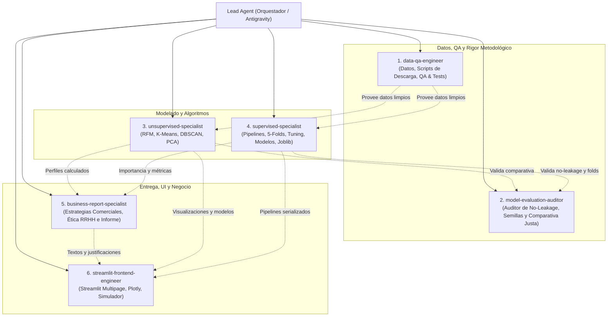

# Design Document: Plataforma Unificada de Inteligencia de Negocios y Analítica Avanzada
**Proyecto:** SI-S11 — Sistemas Inteligentes y Machine Learning  
**Aplicación:** Sistema Integrado en Streamlit Multipage  
**Autor:** Antigravity & Equipo de Ingeniería  
**Fecha:** Noviembre 2026  
**Estado:** Propuesta de Diseño Aprobada para Implementación  

---

## 1. Visión General del Sistema
El objetivo de este proyecto es construir una solución modular de software y ciencia de datos que combine dos problemas industriales estratégicos dentro de una única plataforma interactiva y profesional desarrollada en **Streamlit**:

1. **Módulo 1 (No Supervisado): Segmentación Estratégica de Clientes de Comercio Electrónico**
   - Agrupamiento no supervisado mediante análisis de comportamiento transaccional (RFM + métricas avanzadas de consumo).
   - Implementación y benchmark riguroso de cuatro enfoques: **K-Means**, **DBSCAN**, **PCA + K-Means**, y **PCA + DBSCAN**.
   - Caracterización de perfiles de clientes y diseño de estrategias de retención comercial personalizadas.

2. **Módulo 2 (Supervisado): Sistema Predictivo de Retención y Riesgo de Rotación de Empleados (HR Analytics)**
   - Clasificación binaria (`Attrition`: 0/1) aplicando buenas prácticas de MLOps: prevención de fuga de datos (*data leakage*), imputación y codificación mediante `Pipeline` y `ColumnTransformer`.
   - Comparación y optimización de tres familias de modelos de ensamble y árboles: **Decision Tree**, **Random Forest** y **Gradient Boosting**.
   - Simulador interactivo en tiempo real con evaluación de perfiles y exportación de modelos serializados (`joblib`).

---

## 2. Fuentes de Datos y Estrategia de Descarga

### 2.1 Datasets Utilizados
1. **Comercio Electrónico:** `mashlyn/online-retail-ii-uci` (Dataset UCI Online Retail II, transacciones 2009–2011).
   - *Evaluación técnica:* Es el dataset estándar de oro para segmentación no supervisada RFM. Contiene identificador único por cliente (`Customer ID`), fecha con marca de tiempo (`InvoiceDate`), cantidades (`Quantity`) y precios unitarios (`Price`).
2. **Rotación de Personal:** IBM HR Analytics Employee Attrition & Performance (`WA_Fn-UseC_-HR-Employee-Attrition.csv`).
   - Dataset estándar con 35 atributos demográficos, laborales y de satisfacción, ideal para clasificación binaria supervisada.

### 2.2 Política de Datos y Automatización (`.gitignore` + Downloader)
- **Seguridad y Control de Versiones:** Todos los directorios de datos (`csv/`, `data/`, `*.csv`) están agregados a [`.gitignore`](file:///home/gerardo/dev/python/SI-S11/.gitignore).
- **Módulo de Adquisición de Datos (`src/data/download_datasets.py`):**
  - Verifica si los archivos ya existen localmente en `data/` o `csv/`.
  - Si no existen, utiliza la API de `kaggle` (vía `kaggle.api.kaggle_api_extended.KaggleApi` o `subprocess`/descarga directa verificada) o URL fallback espejo para aprovisionar los datos automáticamente.
  - Valida integridad básica (hash de columnas y conteo mínimo de registros).

---

## 3. Arquitectura del Software y Estructura Modular

El proyecto elimina por completo el uso de notebooks Jupyter para garantizar reproducibilidad, testing unitario y calidad de código de producción.

```text
SI-S11/
├── .gitignore
├── requirements.txt
├── README.md
├── plan/
│   └── design_doc_consolidado.md        <-- Este documento
├── data/                                 <-- Ignorado en git
│   ├── online_retail_II.csv
│   └── WA_Fn-UseC_-HR-Employee-Attrition.csv
├── models/                               <-- Artefactos entrenados serializados (.joblib)
│   ├── hr_best_pipeline.joblib
│   └── kmeans_rfm_pipeline.joblib
├── src/
│   ├── __init__.py
│   ├── config.py                         <-- Rutas, semillas (random_state=42), constantes
│   ├── data/
│   │   ├── __init__.py
│   │   ├── download_datasets.py          <-- Descarga automática / verificación
│   │   └── loaders.py                    <-- Carga de dataframes con tipado y validación
│   ├── ecommerce/
│   │   ├── __init__.py
│   │   ├── feature_engineering.py        <-- Cálculo RFM, Ticket Promedio, Tasa Devolución
│   │   ├── clustering.py                 <-- K-Means, DBSCAN, K-Distances curve
│   │   ├── pca_transform.py              <-- Scree plot, Varianza 90-95%, loadings
│   │   ├── evaluation.py                 <-- Silhouette, Davies-Bouldin, Calinski-Harabasz
│   │   └── business_insights.py          <-- Generación de perfiles y estrategias
│   ├── hr_attrition/
│   │   ├── __init__.py
│   │   ├── preprocessor.py               <-- ColumnTransformer, OneHotEncoder, RobustScaler/StandardScaler
│   │   ├── training.py                   <-- Cross-Validation (5 folds), Grid/RandomizedSearch
│   │   ├── models.py                     <-- DT, RF, GradientBoosting con hiperparámetros
│   │   ├── evaluation.py                 <-- F1, Precision, Recall, ROC-AUC, PR-AUC, Confusion Matrix
│   │   └── inference.py                  <-- Función para predecir sobre nuevos registros
│   └── utils/
│       ├── __init__.py
│       └── metrics_logger.py             <-- Serialización de resultados para UI
├── app/
│   ├── main.py                           <-- Entrada Streamlit Multipage
│   ├── styles/
│   │   └── custom.css                    <-- Estilos modernos (dark/light clean card layout)
│   └── pages/
│       ├── 1_📊_Overview.py              <-- Dashboard ejecutivo integrador
│       ├── 2_🛒_Customer_Segmentation.py <-- Módulo Ejercicio 1 (RFM, PCA, Clustering)
│       └── 3_👥_HR_Employee_Attrition.py  <-- Módulo Ejercicio 2 (Supervisado & Simulador)
```

---

## 4. Especificación Detallada: Módulo 1 (Segmentación de Clientes)

### 4.1 Ingeniería de Características RFM y Enriquecimiento
A partir de transacciones a nivel de ítem:
1. **Limpieza inicial:** Exclusión de cancelaciones (`Invoice` comenzando con 'C' procesadas por separado para calcular tasa de devolución), precios negativos y registros sin `Customer ID`.
2. **Fecha de referencia:** $T_{ref} = \max(\text{InvoiceDate}) + 1\text{ día}$.
3. **Métricas agregadas por cliente:**
   - **Recency ($R$):** Días transcurridos desde su última transacción hasta $T_{ref}$.
   - **Frequency ($F$):** Número de facturas únicas generadas por el cliente.
   - **Monetary ($M$):** Gasto neto total acumulado ($\sum \text{Quantity} \times \text{Price}$).
   - **Ticket Promedio ($AOV$):** $M / F$.
   - **Variedad de Catálogo:** Conteo de `StockCode` distintos adquiridos.
4. **Escalamiento:** Transformación logarítmica / Box-Cox de $R, F, M$ para corregir fuerte asimetría positiva, seguida de `StandardScaler`.

### 4.2 Algoritmos y Metodología Experimental
1. **K-Means Base:**
   - Búsqueda en $K \in [2, 10]$ con `k-means++`, `n_init=20`, `random_state=42`.
   - Evaluación combinada: Gráfico del Codo (*Elbow*), Coeficiente Silhouette, Davies-Bouldin Index (DBI) y Calinski-Harabasz Index (CHI).
2. **DBSCAN Base:**
   - Gráfico de $k$-distancias ($k = 2 \times \text{features} - 1$) para estimar el rango del codo de $\varepsilon$.
   - Grid search razonado sobre $\varepsilon \in [0.2, 1.5]$ y $\text{min\_samples} \in [5, 20]$.
   - Manejo explícito de outliers/ruido ($\text{cluster} = -1$) reportando tasa de cobertura útil.
3. **PCA (Reducción de Dimensionalidad):**
   - Scree Plot y curva de varianza explicada acumulada apuntando a capturar $\ge 90\%$ o $95\%$ de la varianza.
   - Matriz de componentes (*loadings*) para interpretabilidad semántica de los ejes (ej. componente de volumen vs componente de temporalidad).
4. **Modelos Combinados:**
   - **PCA + K-Means:** Ajuste en el subespacio proyectado de componentes principales.
   - **PCA + DBSCAN:** Clustering de densidad en el espacio reducido.
5. **Comparativa Justa:**
   - Matriz comparativa de 4 vías con métricas calculadas sobre la representación original para evitar sesgos dimensionales.
   - Análisis de estabilidad mediante perturbación de semillas (`seeds = [10, 42, 99, 123, 2024]`).

### 4.3 Entrega de Valor y Estrategias Comerciales
Generación automática de arquetipos:
- **Champions / Clientes VIP:** Alta frecuencia, alta monetary, baja recencia. *Estrategia: Programa de lealtad exclusivo, preventas.*
- **En Riesgo / Inactivos de Alto Valor:** Alto monetary histórico, alta recencia. *Estrategia: Campaña de reactivación personalizada vía e-mail con incentivos directos.*
- **Ocasionales / Nuevos Prometedores:** Baja frecuencia, baja recencia, bajo monetary. *Estrategia: Secuencia de onboarding y descuentos cruzados.*

---

## 5. Especificación Detallada: Módulo 2 (Predicción de Rotación de RRHH)

### 5.1 Prevención Rigurosa de Fuga de Datos (*Data Leakage*)
- **Partición Train/Test:** 80% Train, 20% Test con partición estratificada (`stratify=y`, `random_state=42`). El conjunto Test permanece intacto y aislado hasta la evaluación final.
- **Pipeline Integral:** 
  - Variables numéricas: `SimpleImputer(strategy='median')` + `StandardScaler()`.
  - Variables categóricas: `SimpleImputer(strategy='most_frequent')` + `OneHotEncoder(handle_unknown='ignore', drop='first')`.
  - Depuración de columnas sin varianza o con fuga (ej. `EmployeeNumber`, `Over18`, `StandardHours`, `EmployeeCount`).

### 5.2 Modelos y Optimización de Hiperparámetros
Modelos a contrastar bajo la misma semilla y los mismos 5 folds (`StratifiedKFold(n_splits=5)`):
1. **Decision Tree Classifier:**
   - Hiperparámetros: `max_depth` (3 a 15), `min_samples_split` (2 a 20), `min_samples_leaf` (1 a 10), `ccp_alpha` (poda post-poda).
2. **Random Forest Classifier:**
   - Hiperparámetros: `n_estimators` (100 a 400), `max_depth` (5 a 20), `min_samples_leaf` (1 a 5), `class_weight='balanced'`.
3. **Gradient Boosting Classifier:**
   - Hiperparámetros: `n_estimators` (100 a 300), `learning_rate` (0.01 a 0.2), `max_depth` (3 a 7), `subsample` (0.7 a 1.0).

### 5.3 Métrica Principal y Curvas de Decisión
- **Métrica Principal:** **F1-Score para la clase positiva (Attrition = 1)**, priorizando el balance entre detectar a los empleados en riesgo (*Recall*) sin generar falsas alarmas excesivas (*Precision*).
- **Ajuste de Umbral Óptimo (*Threshold Tuning*):** Calculado exclusivamente sobre las probabilidades out-of-fold de validación cruzada.
- **Evaluación Final en Test:**
  - Matriz de confusión.
  - Curva ROC y Curva Precision-Recall (PR-AUC).
  - Feature Importance (MDI y Permutation Importance) para identificar factores determinantes (horas extras, distancia al trabajo, satisfacción salarial).
  - Simulación de inferencia en tiempo real para 5 perfiles sintéticos representativos.

---

## 6. Diseño de la Aplicación Web (Streamlit Multipage)

### 6.1 Look & Feel Profesional
- **Tema:** Dark / Modern Slate con tipografía limpia (Inter / Roboto), tarjetas sombreadas (`metric cards`), badges de estado y diseño responsivo sin recargar elementos pesados.
- **Navegación:** `st.navigation` o barra lateral nativa con iconografía clara:
  1. `1_📊_Overview.py`: Dashboard de síntesis ejecutiva con KPIs consolidados de ambos proyectos.
  2. `2_🛒_Customer_Segmentation.py`: Visualizaciones 2D/3D interactivas con **Plotly** (PCA scatter, Silhouette visualizer, perfiles de clusters en diagramas de radar).
  3. `3_👥_HR_Employee_Attrition.py`: Comparativa de modelos, diagnóstico ROC/PR, análisis de importancia de variables y **Simulador de Riesgo de Empleado** con controles deslizantes e indicadores de riesgo en porcentaje.

### 6.2 Manejo de Estado y Caché
- Uso intensivo de `@st.cache_data` para transformaciones pesadas de pandas.
- Uso de `@st.cache_resource` para la carga y almacenamiento de Pipelines entrenados con `joblib`.

---

## 7. Equipo de Agentes Especializados para el Desarrollo

Para asegurar la máxima calidad técnica, división clara de responsabilidades, rigor metodológico y cumplimiento estricto de la rúbrica académica, se han definido y registrado seis subagentes especializados dentro de la plataforma:



### 7.1 Definición de Roles y Responsabilidades

1. **`data-qa-engineer` (Infraestructura de Datos & QA)**
   - Scripts de descarga automatizada y verificación de integridad de datasets si no existen localmente (`src/data/download_datasets.py`).
   - Gestión de `requirements.txt` e instalación en `.venv`.
   - Control de calidad, auditoría de `.gitignore` y smoke tests de extremo a extremo.

2. **`model-evaluation-auditor` (Auditor de Rigor Metodológico y Estadístico)**
   - Garantizar prevención estricta de *data leakage* (transformaciones aprendidas solo en Train mediante Pipelines).
   - Validar que los 3 modelos supervisados compartan exactamente los mismos 5 folds de `StratifiedKFold`.
   - Verificar que el ajuste de umbral de clasificación se realice exclusivamente sobre probabilidades out-of-fold de validación, nunca sobre Test.
   - Certificar que en clustering las 4 particiones (K-Means, DBSCAN, PCA+K-Means, PCA+DBSCAN) se evalúen sobre el espacio escalado original y las mismas observaciones.
   - Validar pruebas de estabilidad de clustering ante perturbación de semillas.

3. **`unsupervised-specialist` (Machine Learning No Supervisado)**
   - Desarrollo del paquete `src/ecommerce/`.
   - Implementación de las 10 etapas del Trabajo 01: cálculo RFM + variables adicionales, preprocesamiento y escalado compartido, K-Means, DBSCAN, PCA (90–95%), modelos combinados, métricas (Silhouette, DBI, CHI) y análisis de estabilidad.

4. **`supervised-specialist` (Machine Learning Supervisado & MLOps)**
   - Desarrollo del paquete `src/hr_attrition/`.
   - Implementación de las 16 etapas del Grupo 08: prevención de fuga de datos, `Pipeline` con `ColumnTransformer`, validación cruzada estratificada (5 folds), tuning de Decision Tree, Random Forest y Gradient Boosting con métrica principal F1, evaluación final en Test reservado, análisis de importancia de variables e inferencia sobre nuevos casos. Serialización con `joblib` en `models/`.

5. **`business-report-specialist` (Estrategia Comercial, Ética en IA & Negocio)**
   - Formulación de las **3 estrategias comerciales diferenciadas** según las características de cada cluster.
   - Redacción de la respuesta rigurosa a las preguntas de investigación de ambos casos.
   - Redacción del análisis ético obligatorio de IA en RRHH (privacidad, sesgos algorítmicos, toma de decisiones automatizada y límites de uso).
   - Justificación teórica y práctica de la métrica principal F1 por sobre Accuracy.

6. **`streamlit-frontend-engineer` (Frontend, UI/UX & Visualización)**
   - Desarrollo de la plataforma multipágina en `app/`.
   - Implementación de `app/styles/custom.css` con estética moderna corporativa (dark/slate card layout).
   - Creación de páginas: `1_📊_Overview.py`, `2_🛒_Customer_Segmentation.py` (con gráficos interactivos Plotly 2D/3D y radares de clientes) y `3_👥_HR_Employee_Attrition.py` (diagnóstico visual de modelos y simulador de predicción interactivo para colaboradores).

---

## 8. Plan de Ejecución por Fases

| Fase | Entregable Clave | Criterio de Aceptación |
| :--- | :--- | :--- |
| **Fase 1: Infraestructura & Datos** | Script de descarga y verificación de datos, estructuración modular de carpetas. | Dependencias instaladas en `.venv`, datos presentes en `data/` sin comitear a git. |
| **Fase 2: Motor No Supervisado** | Paquete `src/ecommerce/` con RFM, PCA, K-Means, DBSCAN y métricas. | Comparativa de 4 modelos con reporte de métricas y perfiles comerciales documentados. |
| **Fase 3: Motor Supervisado** | Paquete `src/hr_attrition/` con pipelines, tuning de 3 algoritmos y serialización. | Selección de modelo ganador con F1 en validación, refit y guardado de `.joblib`. |
| **Fase 4: Aplicación Streamlit** | Interfaz multipágina moderna con gráficos Plotly y simuladores en tiempo real. | Flujo interactivo completo, sin errores de recarga ni bloqueos de rendimiento. |
| **Fase 5: Documentación & Pulido** | README de ejecución con instrucciones precisas para revisión académica. | Ejecución con un solo comando: `streamlit run app/main.py`. |
